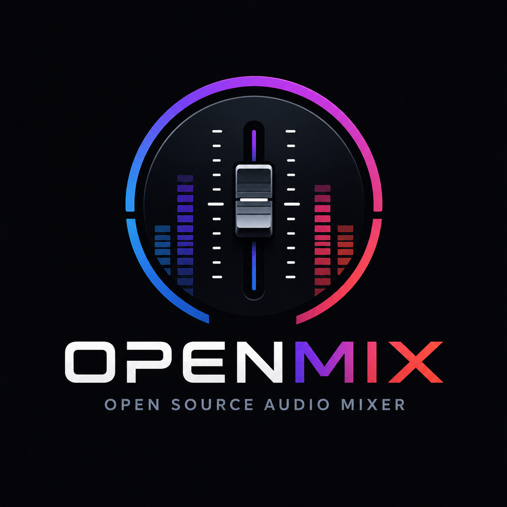
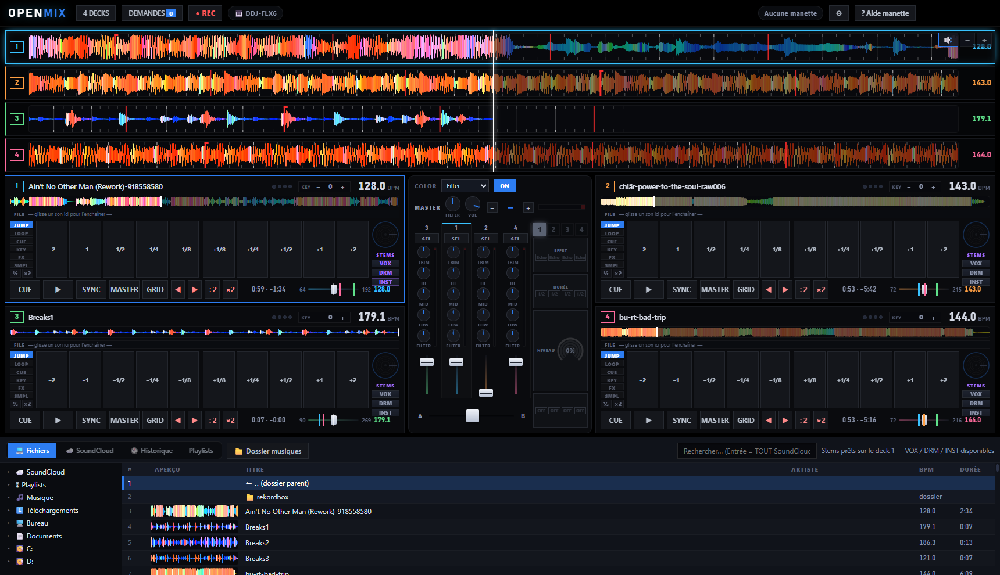

<p align="center">
  
</p>

# OpenMix

🇫🇷 Version française : [README.fr.md](README.fr.md)

**Free and open-source DJ software — 4 decks, DDJ controllers and any USB-MIDI
DJ gear, gamepads, phones.**



OpenMix is complete DJ software, free and open source: BPM detection and
accurate beat grids, 4-deck mixing, and an idea no one else has had: **up to
4 players mixing together on gamepads**, plus a touch console on your phone
and an audience request system — all 100% local, no cloud, no subscription.

The interface is in English by default (French is available in ⚙ Settings).
Bugs and ideas are welcome in the [Issues](https://github.com/blackmagic42/openmix/issues).

## Features

- **4 decks** with 3-band waveforms, rigid beat grids (v13 analysis:
  dual-score BPM sweep, integer lock, kick anchoring), smart sync (the master
  is never re-aligned, and your jog-wheel placement is kept), key shift, beat
  jump, beat-snapped **and** manual IN/OUT loops, persistent hot cues (10 per
  track)
- **Multiplayer on gamepads** (PS/Xbox): navigable control grid,
  JUMP/LOOP/CUE/KEY modes per player, per-player selections with personal FX,
  exclusive bass switching, mix reset on R1
- **STEMS**: vocals/drums/bass/instrumental separation (Demucs, local) with
  per-group mute
- **SoundCloud**: connect your account, playlists, and search the ENTIRE
  catalog (Enter in the search bar)
- **Phone console** (web page or the provided Android APK): 2 landscape
  decks, jog wheels, pads, EQ, faders, library — controls the PC over WiFi
- **Audience requests**: your guests scan a URL, vote for tracks and send you
  messages — no app to install, no account, all local
- **Grid import**: reads the analysis files (ANLZ) already on your drive so
  you can reuse your existing grids without re-analyzing everything
- **DJ decks & controllers**: works with Pioneer DDJ controllers and any
  USB-MIDI DJ gear — every button can be mapped (see below)
- **Keys** detected from the audio (Camelot notation), one-press KEY SYNC,
  key shift with keylock
- **Tempo range** ±6 / ±16 / WIDE per deck (click the range on the jog
  wheel) and − / + buttons in 0.1 BPM steps; a synced deck makes the whole
  group follow
- **Master handoff**: when the master track ends, master passes to the deck
  that has the bass, without changing the BPM — synced decks stay synced
- **Library**: waveform previews without loading, sort by BPM / key /
  duration, tracks already played during the night shown in green,
  drag-and-drop organizing into "My OpenMix music"
- **Download by link** (yt-dlp) for what you are allowed to download
- Mix recording, 2- or 4-deck mode

## DJ decks & controllers (MIDI)

OpenMix works with **any USB-MIDI DJ controller** — no driver to install,
just plug it in and play:

- **Pioneer DDJ recognized automatically**: full 4-channel preset, mapped on
  a real DDJ-FLX6 — two-surface jogs (top = scratch, side = fine nudge),
  volumes, trim, 3-band EQ, filters, tempo, play/cue/sync, IN/OUT/reloop
  loops, performance pads, FX section, channel select, crossfader, and full
  library navigation with the encoder (enter/leave folders and playlists,
  VIEW button)
- **Any other hardware** (Numark, Hercules, Traktor, Denon, MIDI keyboards…):
  **every button, fader, knob or jog can be mapped by MIDI learn** — open
  ⚙ Settings, click the action you want, touch the physical control, and it's
  linked. The mapping is saved PER device and survives restarts
- Notes, CC (absolute and relative) and 14-bit pitch bend are supported —
  high-resolution tempo faders work too

## Installation (PC)

### Easiest: the Windows installer — **no prerequisites**

1. Go to the [Releases](https://github.com/blackmagic42/openmix/releases) page
2. Download **`OpenMix-Setup-x.y.z.exe`**
3. Double-click it: OpenMix installs and starts on its own (a shortcut is created)

> **Nothing else to install.** No Node.js, no npm, no Python: the installer
> already contains everything the software needs (~96 MB). Download,
> double-click, mix. Uninstalling works the usual way from Windows "Apps",
> and your settings are kept.

> Windows SmartScreen may show a warning (unsigned app — certificates are
> expensive, and OpenMix is free): click "More info" → "Run anyway".

### From source (developers, macOS)

Prerequisite: [Node.js](https://nodejs.org) 20+. There is no macOS installer
yet: Mac users can run OpenMix from source with the commands below.

```bash
git clone https://github.com/blackmagic42/openmix.git
cd openmix
npm install
npm start
```

### Building the installer yourself

```bash
cd openmix
npm install
npm run icon          # (optional) regenerates build/icon.ico from build/logo.png
npm run dist          # → dist/OpenMix-Setup-x.y.z.exe (NSIS installer)
npm run dist:portable # → portable version, no installation needed
```

> ⚠️ If the window doesn't open: make sure the `ELECTRON_RUN_AS_NODE`
> environment variable isn't set in your terminal.

Optional:
- **STEMS**: `pip install demucs` (Python 3.10+). Separation runs in the
  background, at low priority, never during playback.
- **Grid import**: if an analysis folder exists on the same PC, there is an
  import button in ⚙ Settings.

## Phone console

The server starts automatically with the app (port **8722**).

- **Browser**: open `http://PC_IP:8722` on the phone (same WiFi)
- **Android APK**: download `OpenMix.apk` from the [Releases](https://github.com/blackmagic42/openmix/releases) — fullscreen
  landscape; the IP is asked for on first launch, then remembered
- **Guests / requests**: have your guests scan `http://PC_IP:8722/guest` —
  votes and messages arrive under the REQUESTS button in the top bar

The phone interface is served from `src/remote.html`: it is re-read on every
load, so you can change it without reinstalling the APK.

## Gamepad

Plug in a gamepad (up to 4). Long-press Share/View = full on-screen controls
help. Each player has their own color, pad mode, selections and personal FX
unit.

### The buttons

The D-pad moves your cursor around the **control grid**: columns are the
decks (+ the FX rack on the right), rows are the knobs (TRIM → HI → MID →
LOW → FILTER), the top row is MASTER, and below FILTER you switch to
**library navigation**.

| Button | Action |
|---|---|
| **D-pad ◀▶▲▼** | Move around the grid (decks × knobs, MASTER at the top, FX rack on the right, library at the bottom) |
| **Cross / A** | Play/Pause · in navigation: open a playlist or **load and play** the track (press again = pause) |
| **Circle / B** (short) | FX + FILTER to 0 (the selection is kept) + hovered knob back to neutral · in navigation: back |
| **Circle / B** (long) | **CUT** selection (see below) |
| **Square / X** (short) | FX duration: 1/2 → 3/4 → 1 → 2 beats |
| **Square / X** (held) | The effect list appears and scrolls — release on the one you want |
| **Triangle / Y** | **CUT**: cuts the selected decks all at once — press again and everything comes back at once |
| **L1 / R1** | Track volume − / + (hold) · MASTER row: the hovered master knob · **R1 with a selection: EVERYTHING to 0 + deselect** |
| **L2 / R2** | The **pads**: left / right half, the row sets the strength (TRIM = strong → FILTER = fine) · FX column: duration ÷2 / ×2 · MASTER row: BPM − / + (synced decks follow) |
| **Share/View** (short) | Change YOUR pad mode: JUMP → LOOP → CUE → KEY → PAD FX → SAMPLER (each player keeps their own) |
| **Share/View** (long) | Full on-screen help |
| **Options/Menu** | Deck BEAT SYNC ON/OFF |
| **Left stick ▲▼** | The hovered knob · **with a selection: the FILTERS of all your selected tracks** |
| **Left stick ◀▶** (held ½ s) | Nudge the track like a CDJ jog wheel (on release, auto-snap keeps your alignment) · **active loop: adjust the loop** (▶ +1 segment, ◀ shrink) |
| **Right stick ▲▼** | Track **FX level** (MASTER row = all) |
| **Right stick ◀▶** (held ½ s) | Zoom the waveforms in / out |
| **L3** (left stick click) | Overall FILTER ON/OFF (COLOR) |
| **R3** (right stick click) | **Select the track** (see below) · FX column: unit ON/OFF |
| **PS/Xbox button** | Cut / restore the hovered knob · on LOW: the **bass switches to this deck** (never two basses at once) |

### SELECTION mode (the heart of multiplayer)

Press **R3** on a deck: the track is **selected** in your color — its FX and
filter are armed in one go. Press again to remove it; you can select several
tracks (they then all react together).

While you have a selection:

- **Left stick ▲▼ = the FILTER** of all your selected tracks at once (the
  right stick stays on FX — never the other way round);
- **Right stick ▲▼ = the FX level** applied to your selection, with YOUR
  personal FX unit (each player has their own);
- **L2 / R2 = the FX duration** (÷2 / ×2) instead of the pads — except in
  LOOP mode, where the loop pads keep priority;
- **Short Circle = everything to zero** (FX cut, filter to neutral) but the
  selection and arming STAY: you can fire an effect again right away;
- **R1 = the big reset**: FX to zero, filters to neutral AND deselect —
  straight back to a clean mix;
- **Triangle = CUT**: the selected decks cut out instantly, press again and
  everything comes back — the classic "drop" effect;
- Two players can select **the same deck**: their effects combine, and the
  display shows each player's color.

## The HTTP API (OpenMix's "SDK")

All of OpenMix can be controlled over HTTP on port 8722 — enough to build
your own remotes, bots or integrations:

| Route | Method | Description |
|---|---|---|
| `/` | GET | Phone console (HTML) |
| `/guest` | GET | Guest page: votes + messages (HTML) |
| `/state` | GET | Full mix state (JSON, ~400 ms freshness): decks (title, BPM, position, tempo, volume, filter, EQ, loop, cues, master, sync), crossfader, master BPM, master volume |
| `/wave?d=N` | GET | Compact waveform of deck N (24 pts/s, 3 bands 0-255) |
| `/lib` | GET | Current library (names + BPM) |
| `/requests` | GET | Guest votes and messages (JSON) |
| `/cmd` | POST | JSON command — see below |
| `/vote` | POST | `{"name": "title", "bpm": 128}` to vote, `{"msg": "text"}` for a message |

### `/cmd` commands

```json
{"action": "play",    "deck": 0}
{"action": "cue",     "deck": 0}
{"action": "sync",    "deck": 0}
{"action": "vol",     "deck": 0, "value": 0.8}
{"action": "filter",  "deck": 0, "value": -0.3}
{"action": "trim",    "deck": 0, "value": 0.1}
{"action": "eq",      "deck": 0, "band": "low", "value": -1}
{"action": "bass",    "deck": 1}
{"action": "jump",    "deck": 0, "value": -1}
{"action": "hotcue",  "deck": 0, "value": 2}
{"action": "pad",     "deck": 0, "mode": "loop", "value": 7}
{"action": "loopin",  "deck": 0}
{"action": "loopout", "deck": 0}
{"action": "tempo",   "deck": 0, "value": 1.02}
{"action": "load",    "deck": 0, "value": 12}
{"action": "mbpm",    "value": 1}
{"action": "mvol",    "value": 0.9}
{"action": "xf",      "value": 0.5}
```

## Code structure

```
openmix/
├── main.js            Electron main process: window, HTTP server
│                      (console/guests), SoundCloud, Demucs, Rekordbox grids
├── preload.js         Secure renderer ↔ main bridge
├── src/
│   ├── index.html     Main interface
│   ├── styles.css     "All black, one accent" design system
│   ├── remote.html    Phone console (2 landscape decks)
│   ├── guest.html     Guest page (votes/messages)
│   └── js/
│       ├── app.js     UI, decks, mixer, multiplayer gamepads, FX
│       ├── engine.js  Web Audio engine: decks, sync/PLL, FX, stems
│       ├── bpm.js     BPM/grid analysis v13
│       ├── library.js Library, cache, SoundCloud, queued analysis
│       ├── gamepad.js Gamepad mapping (up to 4 players)
│       ├── waveform.js Waveform rendering (zoom + minimap)
│       └── midi.js    MIDI learn mapping
└── android-app/       APK source (fullscreen WebView, built without Gradle)
```

## Rebuilding the APK

Requires the Android SDK (build-tools 34+, platform android-34) and a JDK:

```
javac → jar → d8 (build-tools 36) → aapt package → zipalign → apksigner
```

The exact commands are in `android-app/` — the APK only changes if the
native code changes; the interface itself lives on the PC.

## License

MIT — free to use, modify and share.
**OpenMix: free the mix.**

## Trademarks

Pioneer DJ, DDJ, rekordbox, SoundCloud, PlayStation and Xbox are trademarks
of their respective owners. OpenMix is an independent project: it is not
affiliated with, approved by or endorsed by these companies. These names are
mentioned only to indicate which hardware or services OpenMix works with.

OpenMix does not bypass any protection: DRM-protected tracks cannot be
played, and the software says so clearly. No audio samples, presets or files
from any commercial software are distributed with OpenMix.
